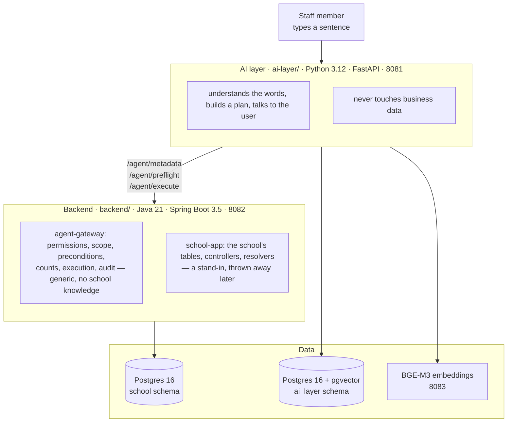
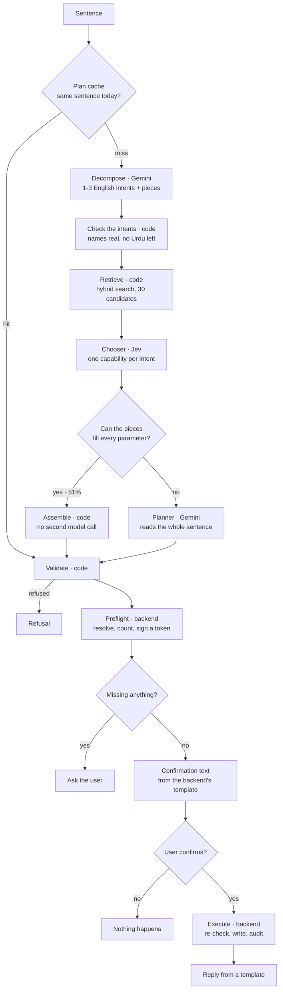
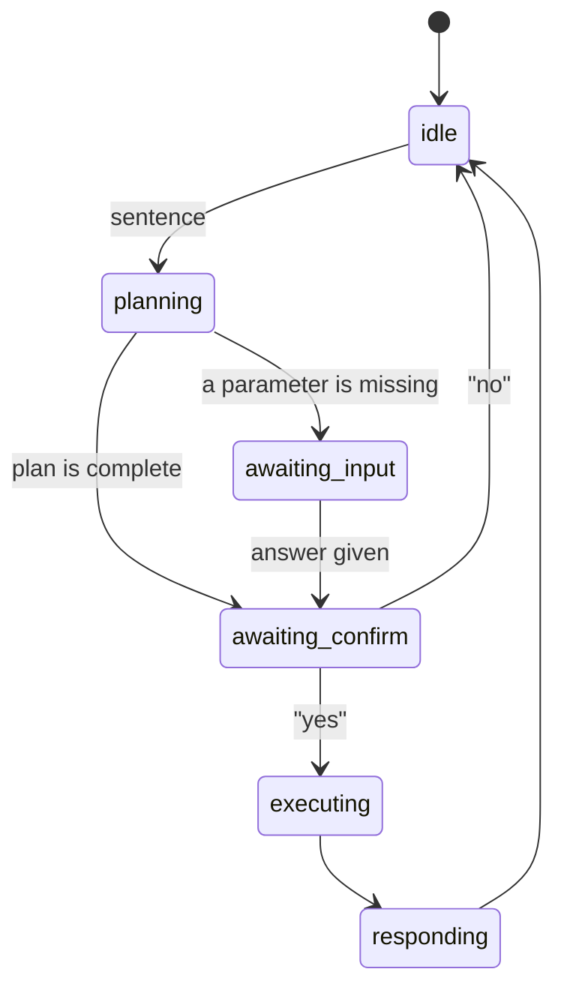
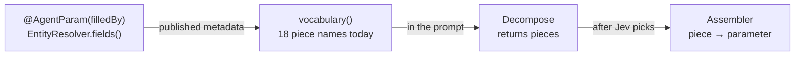
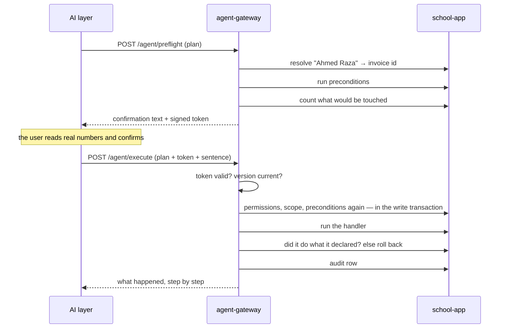
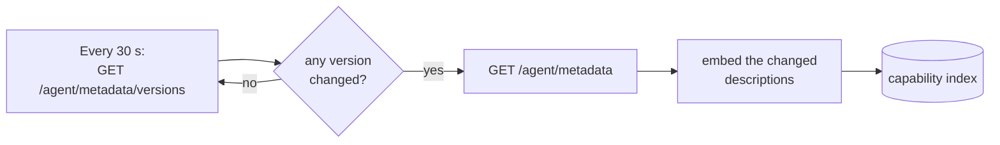

# Architecture and getting started

Branch `lookup-parts`, 28 September 2026. This is the one file to read before touching anything.

---

## 1. What this is

Staff type a sentence in English, Roman Urdu, or a mix of the two. The system works out which action
they mean, shows a confirmation built from real numbers, and runs it only after the backend has
re-checked everything.

```
"class 5 blue ke defaulters ko whatsapp par reminder bhejo"
"how much did we collect this month"
"Ahmed Raza ki September ki fees 5000 naqad mili, record kar do"
```

Two ideas carry the whole design:

**A model chooses, it never acts.** The AI layer builds a *plan* naming a `capability_id`. It has no
URL for any business endpoint and could not reach one if it tried. The backend owns the registry that
turns an id into a call.

**Nothing a model writes reaches the user unchecked.** The confirmation text comes from the
backend's templates and real counts. The plan goes through a validator, then the backend's preflight,
then the user, then the backend's checks a second time inside the write transaction.

---

## 2. Start here

**You need:** Docker, Java 21, Python 3.12 + [uv](https://docs.astral.sh/uv/), about 4 GB of free
memory for the embeddings model, and a free Gemini API key from
[Google AI Studio](https://aistudio.google.com/apikey).

```bash
cd self_aware
make env                # creates .env from .env.example
```

Put your key in `.env` as `AI_LAYER_GEMINI_API_KEY=…`. Never paste a key anywhere else, and never
commit one. A TypeSafe key (`AI_LAYER_TYPESAFE_API_KEY`, from console.typesafe.ai) turns the chooser
on; without it the system still works, just differently (see §8).

```bash
make db-up              # Postgres 16 + pgvector on 5433
make embeddings-up      # BGE-M3 on 8083, downloads ~2 GB the first time
make backend-run        # applies migrations + the demo school, serves 8082
make ai-run             # in another terminal, serves 8081
```

Then open <http://127.0.0.1:8081/> and type a sentence. That page has a **pipeline view** that shows
every stage's input and output for the turn you just ran — it is the fastest way to understand the
system, and worth more than any amount of reading.

Without starting anything:

```bash
make plan Q="class 5 blue ko reminder bhejo"     # plan one sentence and preflight it, nothing runs
make retrieve Q="remind class 5 blue"            # just the candidates retrieval offers
make ai-test-unit                                # no Docker, no model calls
```

**Ports** (all set in `.env`; the defaults in `.env.example` differ where a port was already taken):

| Port | What |
| --- | --- |
| 8081 | AI layer (FastAPI) |
| 8082 | backend (Spring Boot) |
| 5433 | Postgres 16 + pgvector |
| 8083 | BGE-M3 embeddings (Hugging Face TEI) |

---

## 3. The three processes



Two Postgres **login roles**, each owning one schema. The AI layer's role has no privilege at all on
`school` — that is enforced by Postgres, not by convention, so a bug cannot read a student's record.

`agent-gateway` is the product: a library that makes any action safe for any host application. Its
own tests use a made-up "notes" domain so it can never learn about schools. `school-app` is the
stand-in for the real school backend — see [school-backend.md](school-backend.md).

---

## 4. The twelve rules

These are the invariants. Breaking one is a bug even when the tests pass.

1. **The AI layer never queries the business database.** Its only database is the capability index.
2. **A plan carries `capability_id`, never a URL.** Otherwise the AI layer could address anything.
3. **Confirmation text is built by the backend** from declared templates and real counts. A model
   never writes it and never restates a number.
4. **The backend re-checks everything at execute** — permissions, scope, preconditions, versions —
   even though preflight already did. Preflight is for showing the user; execute is enforcement.
5. **Preconditions run after parameters are resolved.** "The invoice must be unpaid" is uncheckable
   until you know which invoice.
6. **Preconditions are re-checked inside the write transaction.** A human sat between preflight and
   execute; state may have moved.
7. **Scope goes in the SQL `WHERE` clause, not a filter afterwards.** A teacher searching "class 5"
   must not be able to tell "no such class" from "not your class".
8. **The count function and the handler share the same repository method.** Re-implementing the
   predicate is how you confirm 17 and send 14.
9. **Everything a model outputs is validated before use.** Typed record, unknown fields rejected,
   every capability id checked against current metadata.
10. **Never hold a database connection across a model call,** and never block the event loop.
11. **Intents are normalised to English** by decompose, whatever the user typed. Retrieval is not a
    language model.
12. **Cache plans, never results.** Data must stay fresh.

---

## 5. One turn, end to end



The stage names in the pipeline view map one-to-one onto the code:
`plan_cache` → `decompose` → `decompose_check` → `embed` → `search` → `fuse` → `choose` →
(`fill` → `fill_plan` | `plan`) → `validate` → `preflight` → `session` → `execute`.

### A session across turns



An unanswered question or confirmation is forgotten after
`AI_LAYER_CHAT_SESSION_TTL_SECONDS` (30 minutes).

---

## 6. Inside the AI layer

`ai-layer/app/`, one folder per stage:

| Folder | Does |
| --- | --- |
| `decompose/` | one Gemini call: the sentence into 1-3 short English intents, plus the pieces. Then checks its own answer: every name it claims to have copied is really in the sentence, and no untranslated Roman Urdu is left in an intent |
| `retrieval/` | hybrid search over the capability index — vector plus full-text, fused with reciprocal rank fusion, 30 candidates |
| `choosing/` | Jev picks one capability per intent from the candidates, with calibrated probabilities |
| `filling/` | builds the plan from the pieces, in code (`pieces.py`, `assembler.py`, `values.py`, `service.py`) |
| `planning/` | the second Gemini call, for what the pieces could not fill |
| `validation/` | the plan validator: the gate every plan passes, from either path |
| `orchestration/` | the conversation — sessions, questions, confirmation, the plan cache |
| `gateway/` | the typed client for `/agent/**`; `models.py` is **generated** from the OpenAPI spec |
| `sync/` | polls the backend for capability changes and keeps the index current |
| `response/` | the words the user sees. Assembled from the backend's text, never written by a model |

`ai-layer/domain/school/` holds the only school-specific vocabulary in the AI layer (a glossary for
decompose, the school calendar). The rest is domain-free on purpose.

### How retrieval scales

The eval runs against a **stress index of 489 capabilities** — the 8 real ones plus 481 distractor
descriptions from the other planning contracts — because a system that retrieves well among 8 tells
you nothing. Design for 489, not for 8.

---

## 7. How parameters get filled (the current design)

This is the newest and least obvious part. Decompose reads the message once and returns, alongside
each intent, **the pieces**: what the user said, split into named parts.

```
"Ahmed Raza ki September ki fees 5000 naqad mili, record kar do"

intent  "Record a payment of 5000 received in cash for Ahmed Raza for September"
pieces  {"student_name": "Ahmed Raza", "month": "September",
         "amount": "5000", "payment_method": "cash"}
```

**The piece names are not hand-written anywhere.** They are read from the published capabilities:
each parameter declares `@AgentParam(filledBy = "payment_method")`, and a looked-up record declares
the parts its resolver searches by. `pieces.vocabulary()` walks the catalog and builds the list
decompose is given, so a new capability is included by the next deploy.



Once Jev has picked `fee.payment.record`, the assembler fills that capability's form:

| Parameter | Filled from | How |
| --- | --- | --- |
| `invoice_id` | `student_name`, `month` | the resolver's declared parts travel as a `lookup`, and the backend matches each part to its own column |
| `amount_received` | `amount` | digits only, commas stripped |
| `route` | `payment_method` | must already be an allowed value (`cash`, `bank_challan`) |
| `payment_date` | `date` | `today`/`aaj` or an ISO date, nothing else |

**It refuses to guess.** Any of these hands the whole message to the planner instead: a date it
cannot work out ("last Friday"), an amount that is not digits, a word Jev was not confident about,
the same words that could name two different records, more than one action where one is incomplete,
or a piece name that was never published. The plan it does build goes through the same validator as
the planner's.

When a word is not already an allowed value ("naqad" for `cash`), a **second, separate Jev call**
asks which allowed value it is — one question per parameter, and the answer is used only above 0.7
confidence. It happens only when needed.

**Measured** (`make measure-pieces`): plan accuracy 89.1% → 89.7%, and **126 of 245 messages (51.4%)
answered with no planner call at all**. A live turn takes 2.7-4 s instead of 7-12 s.

---

## 8. The flags that change the shape

Everything below is in `.env`. These four decide which architecture is running:

| Setting | Default | Effect |
| --- | --- | --- |
| `AI_LAYER_CHOOSER_ENABLED` | `true` | Jev shortlists before the planner. Off (or with no TypeSafe key), the planner sees all 30 candidates: ~2.3 points more accurate, ~1.5-2 s slower |
| `AI_LAYER_PARAMS_FROM` | `planner` | `pieces` turns on the design in §7. Needs the chooser |
| `AI_LAYER_DECOMPOSE_SOURCE` | `gemini` | `translator` swaps the decompose call for a local Roman Urdu translator: faster and free, 4.6 points less accurate |
| `AI_LAYER_PLAN_CACHE_SIZE` | `256` | `0` turns the plan cache off |

`GET /health/ready` says in words which combination is live. Always check it after a config change.

---

## 9. The backend half

A plan is posted twice, and the second time is the one that counts.



Three things worth knowing:

- **The sentence goes to execute** for the audit trail only. The backend validates its length and
  writes it down next to the ids that changed; nothing is parsed from it, so it cannot influence
  what runs. It is the only place the user's own words are stored — the AI layer never logs them.
- **The token is signed by the backend** and covers the exact plan. An altered plan after
  confirmation is refused.
- **A handler that does not do what it declared is rolled back.** If the count said 5 and the
  handler reports 99, the transaction dies. `ExecuteRollbackIT` proves it.

### Metadata sync



The poll is cheap (855 B today, ~53 KB at 489 capabilities); the full fetch happens only on a real
change. What it returns is a **published view**: id, version, module, read_only, description,
disambiguate_from, params, and the effect's `facts`. Preconditions, blast radius, `reverses` and the
reply templates stay on the backend, because the AI layer reads none of them — but the **version is
still a hash of the whole entry**, so a change it cannot see still invalidates its cached plans and
its index row.

---

## 10. Where the numbers come from

Four numbers, measured over 175 labelled sentences and 70 sentences that must be refused, against
the 489-capability index, with today frozen at 14 September 2026:

| | Meaning | Planner path | Pieces path (§7) |
| --- | --- | --- | --- |
| recall@30 | the right capability is among the candidates | 95.4% | 96.0% |
| plan accuracy | exactly one step (or a question) for the right capability | 89.1% | 89.7% |
| refusal correctness | acted exactly when it should have | 91.0% | 91.4% |
| validator catch rate | share of injected faulty plans it refused | 100% | 100% |

Both columns are measured over the same sentences by `make measure-pieces`. The planner column is
the chooser-off baseline; with the chooser on, plan accuracy is 86.9%.

```bash
make measure          # the four numbers; records any missing model answers
make measure-jev      # with and without the chooser
make measure-pieces   # the pieces design against a planner call
make measure-ci       # replays eval/recordings/, calls no model at all
make decompose-repeat # is decompose's intent count stable across runs?
```

**Model answers are recorded.** `ai-layer/eval/recordings/*.json` is keyed by sentence and stamped
with the model, a hash of the system prompt, and the thinking setting. Change a prompt and those
answers are re-asked; leave it alone and the whole eval replays offline for free. That is what CI
runs, and why a code change can be measured without spending quota.

**Quota is the real constraint.** The free Gemini tier allows 15 requests a minute and 500 a day per
project and model. A full re-record is ~465 calls — most of a day. Pace recording runs
(`EVAL_CALLS_PER_MINUTE=12`) and never re-record a prompt casually.

---

## 11. The branches

| Branch | Holds |
| --- | --- |
| `main` | the state before the Gemini/Jev work |
| `jev-chooser` | the chooser experiment on its own |
| `translator-decompose` | the local Roman Urdu translator instead of a Gemini call |
| **`lookup-parts`** | **everything: lookup parts, the pieces design, the published metadata view. Work here** |

---

## 12. Common tasks

**Add a capability.** Write the planning contract first (the id comes from there), annotate the
controller in `school-app`, add the beans it needs, then `make contracts` and `make backend-verify`.
The AI layer needs no change. See [school-backend.md](school-backend.md).

**Change a prompt.** `app/decompose/system_prompt.md`, `app/decompose/pieces_prompt.md` or
`app/planning/system_prompt.md`. This re-hashes the recordings, so budget the quota, then
`make measure`.

**Change the wording a user sees.** `ai-layer/app/response/replies.py` for the AI layer's own words,
or the capability's `@AgentEffect` templates for anything with a number in it. Never a model.

**After changing the backend's published metadata,** run `make contracts` — it regenerates the
OpenAPI spec, the committed snapshot, and the AI layer's Pydantic models. The backend's build fails
when those are stale.

**Before pushing:** `make ai-lint`, `make ai-test`, `make backend-verify`, `make measure-ci`.

---

## 13. Things that will bite you

- **`extra="forbid"` everywhere.** Add a field to a backend record and the AI layer's generated
  model rejects the response until `make contracts` is run.
- **The demo school is frozen at 14 September 2026** and `DatabaseMigrationIT` pins its exact
  numbers. Change the seed and the test together.
- **The seed is adversarial on purpose:** "class 5" matches two sections, "blue" matches two,
  "ahmed" matches two students, and in Class 5 Blue 8 students owe but only 7 guardians exist and
  only 5 have WhatsApp. If your change makes those cases easier, you have probably broken something.
- **Names still match exactly.** "Hasan" does not find "Hassan". Close-spelling matching
  (`pg_trgm`) is the agreed next step and is backend-only.
- **Jev only ever sees the English intent,** never the raw message. Every Roman Urdu loss traces
  back to this, and it is the most promising thing left to try (`with_message=True` already exists).
- **Never log a user's sentence, a token, or a key.** Google's error text can contain the key it
  refused; `GeminiModel` redacts it before the text goes anywhere.

---

## 14. What is still open

- **Is the chooser's accuracy cost worth its speed?** It is on for speed, ~2.3 points behind.
- **Free-tier terms.** On the free tier Google may use requests to improve its products, and every
  sentence carries a student's name. Real school data needs a paid project, redaction, or both.
- **`payment_date` with no date given:** the planner assumed today, the pieces path asks. Asking is
  stricter and one more question.
- **Backend response compression** is off; gzip would take the 489-capability metadata payload from
  ~1.09 MB to 41 KB.

Every decision made so far, and why, is in [README.md](README.md) under "Decisions so far" — 80 of
them. Read the last ten before proposing a change; most ideas have already been measured.
